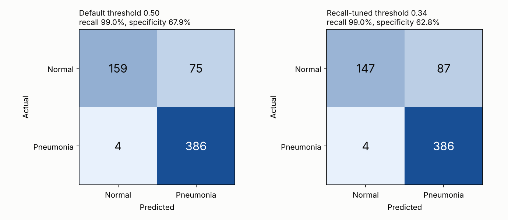
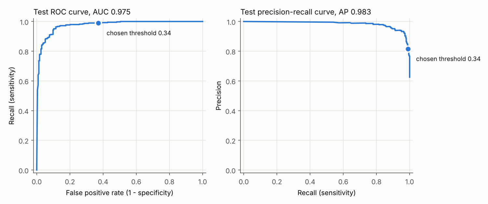
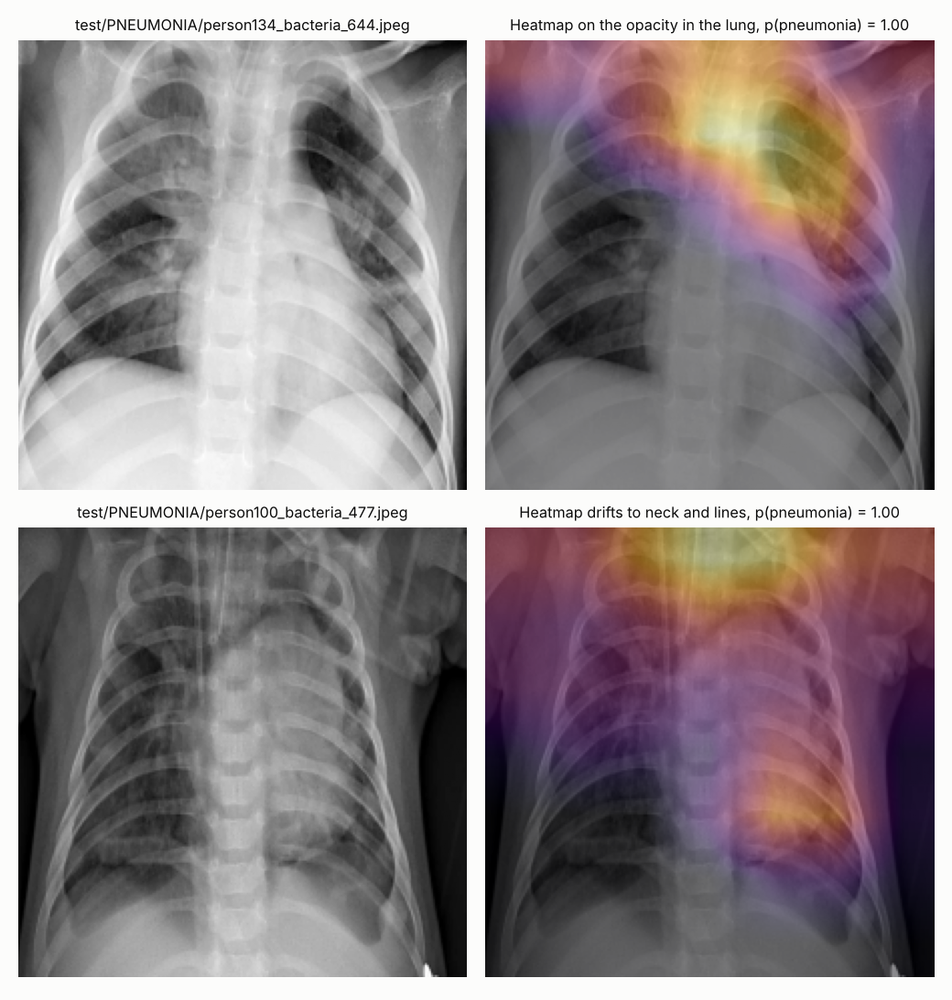

# Pneumonia detection from chest X-rays

Fine-tuned an ImageNet-pretrained CNN (EfficientNet-B0) to detect pneumonia in pediatric chest X-rays, tuned the decision threshold for recall, and added Grad-CAM heatmaps to show which part of the lung drives each prediction.

Everything below was trained and scored on the real Kaggle **Chest X-Ray Images (Pneumonia)** dataset ([paultimothymooney/chest-xray-pneumonia](https://www.kaggle.com/datasets/paultimothymooney/chest-xray-pneumonia), originally from Kermany et al., *Cell* 2018). No synthetic or placeholder images are used anywhere.

## Results on the held-out test set (624 real X-rays)

| | Default threshold 0.50 | Recall-tuned threshold 0.34 |
|---|---|---|
| **Recall (sensitivity)** | **99.0%** (386 / 390) | **99.0%** (386 / 390) |
| Specificity | 67.9% (159 / 234) | 62.8% (147 / 234) |
| Precision | 83.7% | 81.6% |
| F1 | 0.907 | 0.895 |
| Accuracy | 87.3% | 85.4% |

ROC-AUC **0.975**, average precision **0.983**. The model misses **4 of 390** pneumonia cases.




**How to read this.** The threshold was picked on the validation set only: the highest cut-off that keeps validation recall at or above 98% (it came out at 0.34). On the test set that threshold gives the same 99.0% recall as 0.50 and slightly more false alarms, because the four missed cases all score below 0.30. The cost of catching nearly every sick patient is false alarms: about a third of healthy X-rays get flagged. That trade-off is intended for a screening tool, where a false alarm means a second look and a miss means an untreated patient.

Specificity is noticeably lower on the test set than on validation (62.8% vs 99.3%). This is a known property of this dataset: the official test split differs in distribution from the training images, and most published models on it show the same drop. The numbers above are the honest test-set numbers, not validation numbers.

## Grad-CAM: where the model looks



[Full grid](outputs/gradcam_grid.png): four randomly chosen test X-rays from each outcome (caught, missed, false alarm, cleared).

What the heatmaps show:
- For most caught pneumonia cases, the heat sits on the lung fields, on the hazy, consolidated areas (top example).
- Some confident predictions put heat on the neck, shoulders or lines and tubes instead (bottom example). That points to shortcut features: sicker patients more often have lines in place. It is worth knowing before trusting any single prediction.
- For confident normal predictions the map is mostly empty, with faint heat at the image corners. When the model sees no evidence of pneumonia there is little to highlight.

## Method

- **Data.** The original Kaggle folders: train 5,216 (1,341 normal, 3,875 pneumonia), val 16, test 624 (234 / 390). `prepare_data.py` checks these exact counts before doing anything.
- **Validation split.** Kaggle's val folder has only 16 images, too few to choose a checkpoint or threshold. So train + val were pooled and about 10% of **patients** were held out (573 images). The split is by patient id, so no patient appears in both train and validation. The test set is used only once, at the end.
- **Model.** EfficientNet-B0 with ImageNet weights (timm), a new single-logit head, all layers fine-tuned. Grayscale X-rays are resized to 256 px and cropped to 224 px.
- **Augmentation.** Random resized crop (80–100%), rotation ±10°, small shifts, brightness and contrast jitter. There is no horizontal flip, because the heart's position is anatomical.
- **Imbalance.** The training data is 74% pneumonia. Binary cross-entropy with balanced class weights keeps the normal class from being ignored, and recall is then pushed up with the threshold.
- **Training.** AdamW, learning rate 3e-4 on a one-cycle schedule, batch size 32, 8 epochs, about 4 minutes per epoch on a 4-core CPU. The checkpoint with the best validation ROC-AUC was kept (epoch 7, val AUC 0.999).
- **Grad-CAM.** Gradients of the pneumonia logit with respect to the last convolutional layer (`conv_head`), averaged into channel weights, ReLU'd and upsampled ([Selvaraju et al., 2017](https://arxiv.org/abs/1610.02391)). Implemented in `gradcam.py` with hooks and no extra library.

## Reproduce

```bash
pip install -r requirements.txt

# 1. Dataset: download from Kaggle and unzip so that data/chest_xray/{train,val,test}/{NORMAL,PNEUMONIA} exists
kaggle datasets download -d paultimothymooney/chest-xray-pneumonia -p data --unzip

# 2. ImageNet weights for EfficientNet-B0
curl -L -o efficientnet_b0.pth https://github.com/huggingface/pytorch-image-models/releases/download/v0.1-weights/efficientnet_b0_ra-3dd342df.pth

python prepare_data.py --root data/chest_xray --out cache
mkdir -p outputs
python train.py --weights efficientnet_b0.pth --epochs 8
python evaluate.py --target-recall 0.98
python gradcam.py
```

`outputs/model.pt` is the trained model (16 MB), and `outputs/metrics.json` has every number above.

## Files

| File | What it does |
|---|---|
| `prepare_data.py` | Verifies the Kaggle image counts and caches the images as 256 px grayscale arrays |
| `common.py` | Model builder, transforms, dataset class, patient-id parsing |
| `train.py` | Patient-level validation split, class-weighted fine-tuning, checkpoint selection |
| `evaluate.py` | Picks the recall threshold on validation, scores the test set, plots curves and confusion matrices |
| `gradcam.py` | Grad-CAM heatmaps on test X-rays |

## Limitations

- This is a single-site pediatric dataset (ages 1–5, Guangzhou). It says nothing about adults or other hospitals.
- Low specificity on the official test split: about 1 in 3 healthy X-rays is flagged.
- Some heatmaps point to shortcut features (lines, neck, image borders) rather than lung tissue.
- This is a portfolio and learning project, not a medical device.
